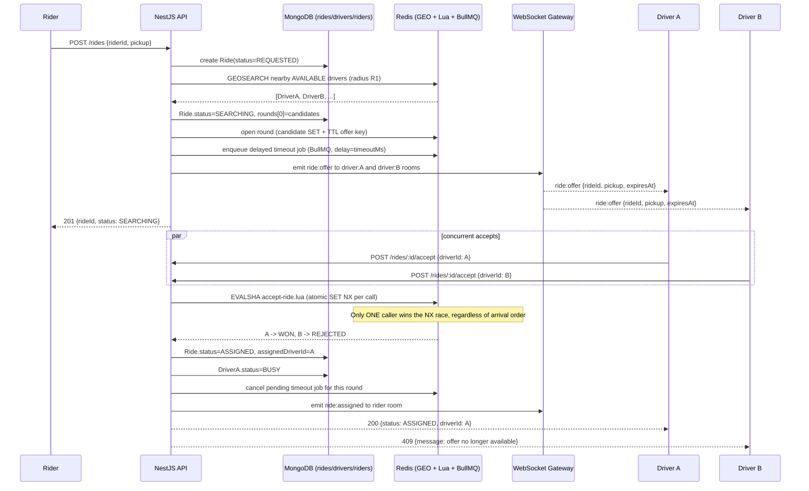

# Vybe Cabs — Real-Time Driver Allocation System

A backend service that simulates the core ride-hailing allocation workflow: a rider
requests a ride, the nearest available drivers are found via Redis geo-search,
multiple drivers are notified simultaneously over WebSockets, and exactly one of
them is assigned — even if several try to accept at the same instant.

**Stack note:** the original brief specified PostgreSQL; per the requester's
explicit instruction this implementation uses **MongoDB** instead for all
persistent storage. Redis is used exactly as specified (mandatory, GEO + atomic
scripting). Everything else follows the brief as given.

- **NestJS** (TypeScript)
- **MongoDB** (Mongoose) — riders, drivers, rides, ride audit trail
- **Redis** — GEO driver index, atomic Lua-scripted acceptance, BullMQ-backed
  timeout/retry scheduling
- **Socket.IO** — real-time driver offers + rider status push

---

## Table of contents

1. [Architecture](#architecture)
2. [Ride lifecycle / state machine](#ride-lifecycle--state-machine)
3. [Concurrency design (the critical part)](#concurrency-design-the-critical-part)
4. [Timeout & retry design](#timeout--retry-design)
5. [Idempotency](#idempotency)
6. [Design choices & assumptions](#design-choices--assumptions)
7. [Setup](#setup)
8. [API reference / curl examples](#api-reference--curl-examples)
9. [Concurrency verification script](#concurrency-verification-script)
10. [Project structure](#project-structure)

---

## Architecture



**Why WebSockets for notification:** the brief allows WebSockets, SSE, polling, or
a simulated log — the concurrency guarantee lives entirely in the Redis Lua
script, not in the transport. WebSockets were chosen because (a) NestJS has
first-class support (`@nestjs/websockets` + Socket.IO), (b) it's the closest
simulation of a real driver app receiving a push notification, and (c) it's
still trivial to drive from a test script — a driver "sees" an offer, then
calls the same `POST /rides/:id/accept` REST endpoint any HTTP client would use.
The REST accept endpoint is transport-agnostic on purpose: whether a driver
learned about the ride via WebSocket, SSE, or polling, acceptance always goes
through the same atomic path.

## Ride lifecycle / state machine

```mermaid
stateDiagram-v2
    [*] --> REQUESTED: POST /rides
    REQUESTED --> SEARCHING: allocation engine starts round 1
    SEARCHING --> SEARCHING: round timeout, no acceptance, retry with wider radius
    SEARCHING --> ASSIGNED: a driver's accept wins the Redis race
    SEARCHING --> TIMEOUT: all configured rounds exhausted, nobody accepted
    REQUESTED --> CANCELLED: POST /rides/:id/cancel
    SEARCHING --> CANCELLED: POST /rides/:id/cancel
    ASSIGNED --> [*]
    TIMEOUT --> [*]
    CANCELLED --> [*]
```



| State | Meaning |
|---|---|
| `REQUESTED` | Ride row created, allocation not started yet (transient — flips to `SEARCHING` synchronously before the API responds). |
| `SEARCHING` | One or more offer rounds are in flight; drivers have been notified and a timeout job is scheduled. |
| `ASSIGNED` | A driver won the atomic accept race; ride is done from an allocation standpoint. |
| `TIMEOUT` | Every configured retry round elapsed with no acceptance (or no candidates found at any radius). |
| `CANCELLED` | *(added beyond the brief's 4 states)* Rider cancelled before assignment. Needed so an in-flight `SEARCHING` ride has a clean terminal state other than `TIMEOUT`, and so any in-flight accept requests can be rejected deterministically instead of silently ignored. |

Each ride also stores a `rounds[]` audit trail (round number, radius used,
candidate driver IDs, start/expiry time, outcome: `PENDING` / `WON` / `EXPIRED`
/ `NO_CANDIDATES`) — visible via `GET /rides/:id`, useful for debugging and for
the verification script's assertions.

## Concurrency design (the critical part)

**Mechanism: Redis Lua scripting (atomic, single round-trip).** See
[`src/common/redis/lua/accept-ride.lua`](src/common/redis/lua/accept-ride.lua).

Every ride round opens three Redis keys:

- `ride:{id}:round:{n}:candidates` — a SET of the driver IDs actually offered this round.
- `ride:{id}:round:{n}:offer` — a key that only `EXISTS` while the round is open; it carries a `PX` TTL equal to the round's timeout window, so it self-expires even if the app crashes.
- `ride:{id}:assigned` — unset until a driver wins; then holds the winning driver ID forever (until cleanup).

When a driver calls `POST /rides/:id/accept`, the API runs one Lua script that,
**atomically inside Redis** (no other client can interleave):

1. Rejects the call outright if the driver isn't in this round's candidate set (`-1`).
2. Rejects the call if the round is no longer open — expired or already closed by a winner (`0`), *unless* this driver is already the recorded winner, in which case it's treated as idempotent success (`2`).
3. Otherwise does `SET assigned {driverId} NX` — Redis's `NX` flag guarantees that across any number of simultaneous callers, exactly one `SET` succeeds. The winner immediately `DEL`s the offer key too, closing the round instantly rather than waiting out the TTL.

Because this is a single Lua script (single `EVALSHA` round trip), there is no
window between "check" and "set" for another request to sneak in — this is the
same guarantee a `SELECT ... FOR UPDATE` + transaction would give in Postgres,
achieved instead through Redis's single-threaded script execution model. No
external distributed-lock library is needed because the whole check-and-set
fits in one script.

The Node/NestJS layer (`RidesService.acceptRide`) never itself decides who
wins — it only interprets the Lua script's return code and persists the result
to MongoDB. MongoDB is not the source of truth for *who wins the race*; Redis
is. Mongo is updated once, by the single request that Redis told is the winner,
so there's no double-write race in Mongo either.

This is proven under real concurrent load by
[`scripts/concurrency-test.ts`](scripts/concurrency-test.ts) — see
[Concurrency verification script](#concurrency-verification-script).

## Timeout & retry design

Round timeouts are scheduled with **BullMQ** (a Redis-backed delayed job
queue): when a round opens, a job is enqueued with `delay = ALLOCATION_TIMEOUT_MS`
and `jobId = ride:{id}:round:{n}` (so it can be looked up/cancelled precisely).

When the job fires (`AllocationTimeoutProcessor` → `AllocationService.handleRoundTimeout`):

1. Re-read the ride from Mongo. If it's no longer `SEARCHING`, or the ride has
   already moved past this round, the job is a **no-op** — this is what makes
   "driver accepts right as the timeout fires" safe: whichever side wins the
   underlying Redis state transition first is authoritative, and the loser's
   side effects are skipped.
2. Otherwise, close the round and either start the next round with a wider
   search radius (`ALLOCATION_RADIUS_KM_ROUNDS`, e.g. `3km → 6km → 10km`) or,
   if this was the last configured round, mark the ride `TIMEOUT`.

**The "accept lands just after timeout fires" edge case specifically:** this is
handled by the Lua script's `EXISTS(offerKey)` check, independent of the BullMQ
job. The offer key's own Redis `PX` TTL expires at the same wall-clock instant
the BullMQ job is scheduled to fire, so even if the BullMQ worker is briefly
delayed (GC pause, event-loop lag, etc.), a late accept is still correctly
rejected the moment the TTL lapses — the queue is only responsible for
*advancing the ride to the next round*, not for gating acceptance. Conversely,
if an accept wins a fraction of a second *before* the timeout job runs, the
winning call already deleted the offer key and set the assignment, so when the
delayed job does fire it sees `status != SEARCHING` and exits immediately.

If a round finds zero candidate drivers at all (nobody within radius), it's
immediately advanced to the next round rather than waiting out the full
timeout — see `RoundOutcome.NO_CANDIDATES`.

## Idempotency

A driver's accept call can be retried safely at any point:

- **Retried by the winner** (e.g. client timeout + automatic retry, double-tap in
  a driver app): the Lua script detects `assigned == thisDriver` and returns
  `ALREADY_YOURS` (`2`). The API responds `200 { idempotent: true }` with the
  same payload as the original win — never a new assignment, never an error.
- **Retried by a loser**: still gets `409 Conflict` every time, consistently.
- **Retried by a driver never offered the ride**: still gets `403 Forbidden`
  every time.

No matter how many times any accept request is retried, in any order, relative
to any other, MongoDB ends up with exactly one `assignedDriverId` for the ride.
This is verified directly by the script (Test 2).

## Design choices & assumptions

Made explicit here per the instruction to avoid silent assumptions:

- **No authentication.** The brief doesn't mention auth and it's orthogonal to
  the evaluation criteria (geo search, concurrency, state machine, idempotency).
  Riders/drivers/rides are identified by MongoDB ObjectId; any caller can act as
  any rider/driver. A production system would add auth in front of this.
- **`BUSY` is system-managed.** A driver can self-report `AVAILABLE`/`OFFLINE`
  via `POST /drivers/:id/status`, but `BUSY` is only ever set by the allocation
  engine on assignment (`POST /drivers/:id/status {status:"BUSY"}` is rejected
  with 400) — otherwise a driver could fake availability mid-race.
  `DriversService.markAvailableAgain` exists for completeness (e.g. once a ride
  completes) but there's no `POST /rides/:id/complete` endpoint, since ride
  completion/trip-tracking is outside this assignment's scope (allocation only).
- **`CANCELLED` state added** beyond the brief's 4 named states — see the state
  table above for why.
- **Allocation starts synchronously inside `POST /rides`.** The first round's
  geo-search + WebSocket notify all happen before the API responds, so the
  `201` response already includes `status: SEARCHING` and the round-1 candidate
  list. This keeps the demo/test scripts simple (no polling needed to see who
  was offered) and all steps are fast (Redis ops), so it doesn't meaningfully
  block the request.
- **Retry radius is configurable, not hardcoded**: `ALLOCATION_RADIUS_KM_ROUNDS`
  (default `3,6,10`) implicitly defines both the radius *and* the number of
  rounds (`maxRounds = radiusKmRounds.length`).
  `ALLOCATION_CANDIDATES_PER_ROUND` (default `5`) caps how many drivers are
  notified per round.
- **Drivers already offered in an earlier round are excluded** from later
  rounds' candidate search (`alreadyTried` in `AllocationService.runRound`), so
  a driver who ignored round 1 isn't re-spammed in round 2.
- **This sandbox has no Docker/`gh` CLI available**, so the code here is
  type-checked (`tsc --noEmit`) and built (`nest build`) successfully, but not
  runtime-exercised against live Mongo/Redis containers in this environment —
  do that via `docker compose up` per the Setup section below before treating
  it as verified end-to-end.

## Setup

### Option A — Docker Compose (recommended, matches the brief's ask)

```bash
cp .env.example .env   # optional, docker-compose.yml already sets equivalent env vars
docker compose up --build
```

This starts MongoDB (`:27017`), Redis (`:6379`), and the API (`:3000`).

### Option B — run locally against your own Mongo/Redis

```bash
npm install
cp .env.example .env   # edit MONGODB_URI / REDIS_HOST / REDIS_PORT if needed
npm run start:dev
```

### Seed demo data

```bash
npm run seed
```

Creates one rider and 6 drivers clustered around a pickup point in Bengaluru
(one deliberately far away, to demonstrate the round-2/3 radius expansion), and
prints a ready-to-run `curl` command for requesting a ride.

## API reference / curl examples

```bash
BASE=http://localhost:3000

# Create a rider
curl -s -X POST $BASE/riders -H 'Content-Type: application/json' \
  -d '{"name":"Demo Rider","phone":"+91-9000000000"}'

# Create a driver
curl -s -X POST $BASE/drivers -H 'Content-Type: application/json' \
  -d '{"name":"Asha Verma","phone":"+91-9100000001","licensePlate":"KA01AB1001"}'

# Driver reports location (updates Redis GEO index if the driver is AVAILABLE)
curl -s -X POST $BASE/drivers/<driverId>/location -H 'Content-Type: application/json' \
  -d '{"lat":12.9720,"lng":77.5950}'

# Driver goes online (added to Redis GEO search index)
curl -s -X POST $BASE/drivers/<driverId>/status -H 'Content-Type: application/json' \
  -d '{"status":"AVAILABLE"}'

# Rider requests a ride -> triggers geo search + notifies nearby drivers
curl -s -X POST $BASE/rides -H 'Content-Type: application/json' \
  -d '{"riderId":"<riderId>","pickup":{"lat":12.9716,"lng":77.5946}}'

# Poll ride status (or listen on the WebSocket - see below)
curl -s $BASE/rides/<rideId>

# Driver accepts (this is the endpoint the concurrency test hammers concurrently)
curl -s -X POST $BASE/rides/<rideId>/accept -H 'Content-Type: application/json' \
  -d '{"driverId":"<driverId>"}'

# Rider cancels before assignment
curl -s -X POST $BASE/rides/<rideId>/cancel
```

A ready-to-import collection with the same flow (and Postman test scripts that
auto-chain the IDs) is at
[`postman/VybeCabs.postman_collection.json`](postman/VybeCabs.postman_collection.json).

**WebSocket events** (Socket.IO, default namespace `/`):

- Client → server: `register` `{ role: "driver" | "rider", id: "<mongoId>" }` — joins the socket to that participant's room.
- Server → driver: `ride:offer` `{ rideId, round, pickup, dropoff, expiresAt }`
- Server → driver: `ride:offer:closed` `{ rideId, reason: "ASSIGNED" | "CANCELLED" }`
- Server → rider: `ride:assigned` `{ rideId, driverId }`
- Server → rider: `ride:timeout` `{ rideId }`

## Concurrency verification script

This is the automated proof for requirement #6 — run it against a live instance:

```bash
docker compose up --build -d      # or npm run start:dev locally
npm run verify:concurrency
```

What it does:

1. Creates 1 rider + 8 drivers, all positioned within round-1 search radius of
   a pickup point, all `AVAILABLE`.
2. Requests a ride and confirms all 8 were offered in round 1.
3. **Fires all 8 `POST /rides/:id/accept` calls at the same instant** via
   `Promise.all`, then asserts: exactly one `200 { idempotent:false }`, exactly
   seven `409`, and MongoDB's `Ride.assignedDriverId` matches the one HTTP
   winner.
4. Re-sends the winner's accept call and asserts it's a `200 { idempotent:true
   }`, not a second assignment or an error.
5. Sends an accept from a driver who was never offered the ride and asserts
   `403`.
6. Prints a `PASS`/`FAIL` line per assertion and exits non-zero if anything
   failed — safe to wire into CI.

Optionally also proves the timeout/retry path (slower — waits out all
configured rounds for a ride with zero reachable drivers):

```bash
npm run verify:concurrency -- --with-timeout-test
```

A Jest/`supertest` equivalent of the same race-condition proof (useful if you'd
rather run it as a conventional test suite / wire it into CI) lives at
[`test/concurrency.e2e-spec.ts`](test/concurrency.e2e-spec.ts):

```bash
docker compose up -d mongo redis
MONGODB_URI=mongodb://localhost:27017/vybe_cabs REDIS_HOST=localhost REDIS_PORT=6379 npm run test:e2e
```

> Both verification methods assume they're running against an otherwise-idle
> Mongo/Redis (a fresh `docker compose up` gives you this). If you've been
> manually poking the API with `curl`/Postman using the *same* fixed demo
> pickup point beforehand, leftover `AVAILABLE` drivers sitting at the same
> coordinates can end up in a later test run's round-1 candidate set instead
> of the drivers the test just created, which throws off the exact
> winner/conflict counts (not a concurrency bug — the atomic accept logic
> itself is still exactly-one-winner regardless of who the candidates are;
> it's just a test-data hygiene concern for repeated manual runs against a
> reused database). `docker compose down -v && docker compose up --build` for
> a clean slate.

## Project structure

```
src/
  common/
    redis/            Redis client, GEO + Lua-script wrapper, accept-ride.lua
    enums/             RideStatus, DriverStatus, RoundOutcome
  config/              typed env-var configuration
  realtime/            single Socket.IO gateway (driver offers + rider push)
  riders/              Rider schema, CRUD
  drivers/             Driver schema, CRUD, location/status, Redis GEO sync
  rides/
    allocation.service.ts        the allocation engine (rounds, geo search, retry)
    rides.service.ts             request/accept/cancel orchestration
    processors/                  BullMQ timeout worker
scripts/
  seed.ts                        demo data
  concurrency-test.ts             requirement #6 verification script
postman/
  VybeCabs.postman_collection.json
docker-compose.yml                 Mongo + Redis + API
Dockerfile
```
